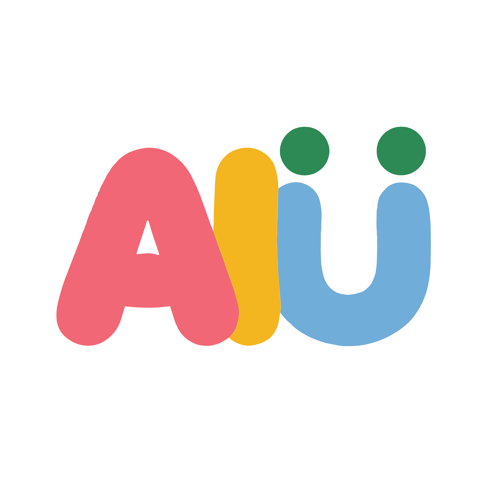

# Animal Island UI

<div align="center">
    
</div>
<p align="center">
    <a href="LICENSE"></a>
    <a href="https://www.npmjs.com/package/animal-island-ui"></a>
    <a href="https://www.npmjs.com/package/animal-island-ui"></a>
    
    <br/>
    
    
    <a href="https://github.com/guokaigdg/animal-island-ui/stargazers"></a>
    <a href="https://atomgit.com/guokaigdg/animal-island-ui"></a>
</p>

<p align="center">
    <a href="https://trendshift.io/repositories/34594?utm_source=trendshift-badge&amp;utm_medium=badge&amp;utm_campaign=badge-trendshift-34594" target="_blank" rel="noopener noreferrer"></a>
    <a href="https://hellogithub.com/repository/guokaigdg/animal-island-ui" target="_blank"></a>
    <a href="https://atomgit.com/guokaigdg/animal-island-ui"></a>
</p>

<p align="center">
    English | <a href="./docs/README.zh-CN.md">简体中文</a> | <a href="./docs/README.ja.md">日本語</a>
</p>

<h2>
    
    Introduction
</h2>

A lightweight, cozy React + TypeScript UI component library with an original island-style design language. Every visual element, layout, icon, and animation is crafted from scratch.

<h2>
    
    Preview
</h2>

- Online Preview: [animal-island-ui](https://guokaigdg.github.io/animal-island-ui/#/)

<h2>
    
    Related
</h2>

- Icons (**naive-icons**): <https://github.com/guokaigdg/naive-icons>
- Vue version (**animal-island-vue**): <https://github.com/guokaigdg/animal-island-vue>
- WeChat Mini Program version (**animal-island-wx**): <https://github.com/lns567/animal-island-wx>

<h2>
    
    Use AI to Generate animal-island-ui Pages
</h2>

### Option 1: Install the skill (recommended for AI coding agents)

Using an AI coding agent (Claude Code / Codex / Cursor)? Install the
[animal-island-ui-style skill](./skills/animal-island-ui-style/README.md):

```bash
skills add guokaigdg/animal-island-ui
```

### Option 2: One-click prompt (no code, nothing to install)

Non-developer and don't want to write code yourself? Use the
[one-click prompt](./docs/one-click-prompt.md) — no npm, no build step.

**4 steps:**

1. Copy the prompt block from [`docs/one-click-prompt.md`](./docs/one-click-prompt.md).
2. Paste into any AI tool that can fetch URLs (Cursor / Claude / ChatGPT / Gemini / v0 / Bolt) and send.
3. The AI asks what page you want — reply in one phrase (e.g. "personal blog", "product list", "FAQ").
4. Save the `index.html` it returns and double-click to preview.

<h2>
    
    Installation
</h2>

```bash
npm install animal-island-ui
```

<h2>
    
    Quick Start
</h2>

> ⚠️ **Important**: Please make sure to import the styles with `import 'animal-island-ui/style'`, otherwise the components will have no styles or fonts!

```tsx
import { Button, Card } from 'animal-island-ui';
import 'animal-island-ui/style';

function App() {
    return (
        <div>
            <Button type="primary">Start Adventure</Button>
            <Card color="app-blue">Welcome to the island!</Card>
        </div>
    );
}
```

<h2>
    
    Documentation
</h2>

Routed by audience and scenario (English primary; Chinese mirrors under [`docs/zh-CN/`](./docs/zh-CN/)):

| Document                                                                      | Purpose                                                                                                                                                    |
| ----------------------------------------------------------------------------- | ---------------------------------------------------------------------------------------------------------------------------------------------------------- |
| [`docs/design-system/`](./docs/design-system/README.md)                       | Canonical design definition (single source of truth) — tokens, design rules, pixel-exact per-component specs, CSS variable template.                       |
| [`skills/animal-island-ui-style/`](./skills/animal-island-ui-style/README.md) | Installable Agent skill (`skills add guokaigdg/animal-island-ui`) — React project usage + standalone-HTML generation, with per-component props references. |
| [`docs/one-click-prompt.md`](./docs/one-click-prompt.md)                      | One-click prompt for non-developers — paste one bootstrap prompt, the AI fetches the specs itself and returns a ready `index.html`.                        |
| [`docs/design-prompts.md`](./docs/design-prompts.md)                          | Prompts for design/image tools (v0 / Figma AI / Midjourney / DALL-E), linking to the canonical spec files.                                                 |
| [`docs/development/`](./docs/development/README.md)                           | Development guide for this repository — structure, component development, coding standards, testing, build contract.                                       |
| [`docs/adr/`](./docs/adr/README.md)                                           | Architecture decision records.                                                                                                                             |
| [`AGENTS.md`](./AGENTS.md)                                                    | Entry point for coding agents working in this repository.                                                                                                  |
| [`CONTRIBUTING.md`](./CONTRIBUTING.md)                                        | Contributing guide.                                                                                                                                        |

<h2>
    
    Local Development
</h2>

```bash
# Clone the repository
git clone https://github.com/guokaigdg/animal-island-ui.git
cd animal-island-ui

# Install dependencies
npm install

# Start Demo development server
npm run dev

# Build component library
npm run build

# Build Demo site
npm run build:demo
```

<h2>
    
    License & Disclaimer
</h2>

- Distributed under the **MIT License** — free to use, copy, modify, merge, publish, distribute, sublicense, and sell copies of the Software, including in commercial products (see the [LICENSE](LICENSE) file for the full text). The copyright notice and this permission notice must be included in all copies or substantial portions of the Software.
- The Software is provided "AS IS", without warranty of any kind; the authors are not liable for any claims, damages, or other liability arising from its use. Users are solely responsible for any risks arising from the use of this component library.
- This is an independently created open-source project. It is not an official product of any game company and has no association, authorization, or cooperation with any company or its products.
- All visual assets (icons, illustrations, animations) in this repository are original works created for this project.

<h2>
    
    Support
</h2>

- The easiest way to support is to give it a star and share it. If you have ideas or suggestions about the project, feel free to open an [Issue](https://github.com/guokaigdg/animal-island-ui/issues) or submit a PR.

- If the project has been helpful to you, you could also buy the developer's cat a can of tuna — meowsters are the real fuel that keeps the island running. [Sponsor this Island](https://guokaigdg.github.io/home/payment.html)
