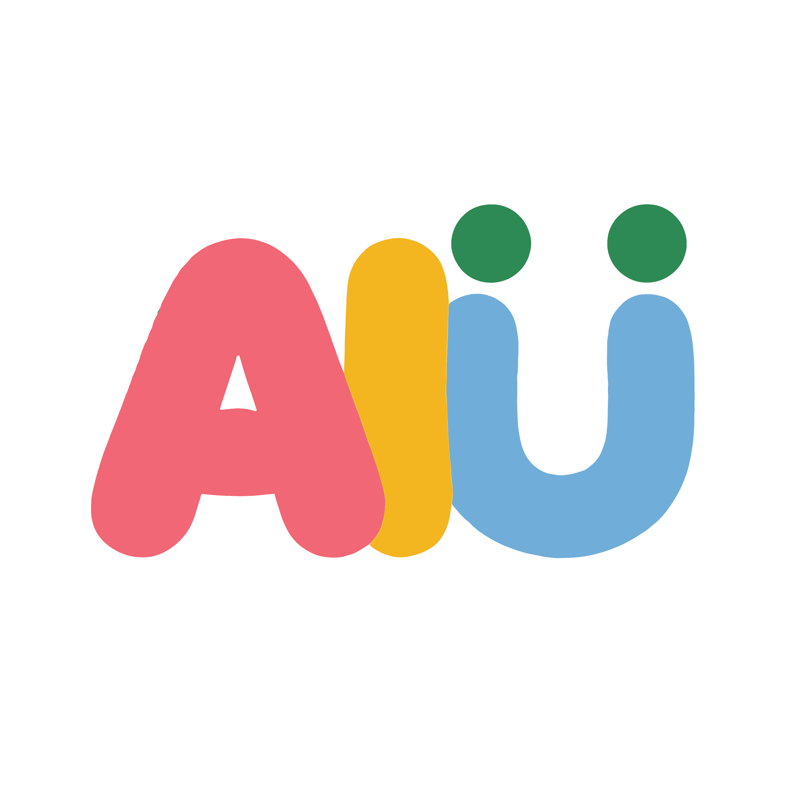

# Animal Island UI

<div align="center">
    
</div>
<p align="center">
    <a href="../LICENSE"></a>
    <a href="https://www.npmjs.com/package/animal-island-ui"></a>
    <a href="https://www.npmjs.com/package/animal-island-ui"></a>
    
    <br/>
    
    
    <a href="https://github.com/guokaigdg/animal-island-ui/stargazers"></a>
    <a href="https://atomgit.com/guokaigdg/animal-island-ui"></a>
</p>

<p align="center">
    <a href="https://trendshift.io/repositories/34594?utm_source=trendshift-badge&amp;utm_medium=badge&amp;utm_campaign=badge-trendshift-34594" target="_blank" rel="noopener noreferrer"></a>
    <a href="https://hellogithub.com/repository/guokaigdg/animal-island-ui" target="_blank"></a>
    <a href="https://atomgit.com/guokaigdg/animal-island-ui"></a>
</p>

<p align="center">
    <a href="../README.md">English</a> | <a href="./README.zh-CN.md">简体中文</a> | 日本語
</p>

<h2>
    
    はじめに
</h2>

軽量で、ゆったりとした React + TypeScript UI コンポーネントライブラリ。オリジナルのアイランドスタイルのデザイン言語を採用し、すべての視覚要素・レイアウト・アイコン・アニメーションを一からデザインしています。

<h2>
    
    プレビュー
</h2>

- オンラインプレビュー：[animal-island-ui](https://guokaigdg.github.io/animal-island-ui/#/)

<h2>
    
    関連プロジェクト
</h2>

- アイコン（**naive-icons**）：<https://github.com/guokaigdg/naive-icons>
- Vue 版（**animal-island-vue**）：<https://github.com/guokaigdg/animal-island-vue>
- WeChat ミニプログラム版（**animal-island-wx**）：<https://github.com/lns567/animal-island-wx>

<h2>
    
    AI ツールで animal-island-ui スタイルのページを生成
</h2>

### 方式 1：skill をインストール（AI コーディングエージェント推奨）

AI コーディングエージェント（Claude Code / Codex / Cursor）を使っていますか？[animal-island-ui-style skill](../skills/animal-island-ui-style/README.md) をインストールするだけです：

```bash
skills add guokaigdg/animal-island-ui
```

### 方式 2：ワンクリックプロンプト（コード不要・インストール不要）

開発者ではない方、コードを書きたくない方はこちらへ。[ワンクリックプロンプト](./one-click-prompt.md)を使えば、npm もビルドツールも不要です。

**4 ステップで利用できます：**

1. [`docs/one-click-prompt.md`](./one-click-prompt.md) のプロンプトコードブロックをコピーします。
2. URL にアクセスできる任意の AI ツール（Cursor / Claude / ChatGPT / Gemini / v0 / Bolt）に貼り付けて送信します。
3. AI がどんなページを作るか聞いてくるので、一言で答えるだけです（例：「個人ブログ」「商品一覧」「FAQ」）。
4. AI が出力した `index.html` を保存し、ダブルクリックでプレビューできます。

<h2>
    
    インストール
</h2>

```bash
npm install animal-island-ui
```

<h2>
    
    クイックスタート
</h2>

> ⚠️ **重要**：`import 'animal-island-ui/style'` のインポートを忘れないでください。忘れた場合、コンポーネントにスタイルとフォントが適用されません！

```tsx
import { Button, Card } from 'animal-island-ui';
import 'animal-island-ui/style';

function App() {
    return (
        <div>
            <Button type="primary">冒険を始める</Button>
            <Card color="app-blue">島へようこそ！</Card>
        </div>
    );
}
```

<h2>
    
    ドキュメント
</h2>

対象読者・用途別に整理（主ドキュメントは英語、中国語ミラーは [`docs/zh-CN/`](./zh-CN/)）：

| ドキュメント                                                                   | 用途                                                                                                                                                                       |
| ------------------------------------------------------------------------------ | -------------------------------------------------------------------------------------------------------------------------------------------------------------------------- |
| [`docs/design-system/`](./design-system/README.md)                             | デザインシステムの基準となる定義（single source of truth）—— デザイントークン、デザインルール、コンポーネント単位のピクセル仕様、CSS 変数テンプレート。                    |
| [`skills/animal-island-ui-style/`](../skills/animal-island-ui-style/README.md) | インストール可能な Agent skill（`skills add guokaigdg/animal-island-ui`）—— React プロジェクトでの使用 + 単一 HTML ファイル生成、コンポーネント別 props リファレンス付き。 |
| [`docs/one-click-prompt.md`](./one-click-prompt.md)                            | 非開発者向けワンクリックプロンプト —— ブートストラッププロンプトを貼り付けるだけで、AI が仕様ファイルを取得し、ダブルクリックでプレビューできる `index.html` を返します。  |
| [`docs/design-prompts.md`](./design-prompts.md)                                | デザイン / 画像生成ツール向けプロンプト（v0 / Figma AI / Midjourney / DALL-E）、基準となる仕様ファイルへのリンク付き。                                                     |
| [`docs/development/`](./development/README.md)                                 | 本リポジトリの開発ドキュメント —— ディレクトリ構造、コンポーネント開発、コーディング規約、テスト、ビルド規格。                                                             |
| [`docs/adr/`](./adr/README.md)                                                 | アーキテクチャ決定記録（ADR）。                                                                                                                                            |
| [`AGENTS.md`](../AGENTS.md)                                                    | 本リポジトリで作業するコーディングエージェントのエントリポイント。                                                                                                         |
| [`CONTRIBUTING.md`](../CONTRIBUTING.md)                                        | コントリビューションガイド。                                                                                                                                               |

<h2>
    
    ローカル開発
</h2>

```bash
# リポジトリをクローン
git clone https://github.com/guokaigdg/animal-island-ui.git
cd animal-island-ui

# 依存パッケージをインストール
npm install

# Demo 開発サーバーを起動
npm run dev

# コンポーネントライブラリをビルド
npm run build

# Demo サイトをビルド
npm run build:demo
```

<h2>
    
    ライセンスと免責事項
</h2>

- 本プロジェクトは **MIT ライセンス** の下で公開されています —— ソフトウェアのコピーを自由に使用、複製、改変、統合、公開、配布、サブライセンス、販売できます（商用利用を含む。全文は [LICENSE](../LICENSE) ファイルを参照）。すべてのコピーまたは相当な部分に、上記の著作権表示とこの許諾表示を含める必要があります。
- 本ソフトウェアは「現状有姿」で提供され、いかなる保証も伴いません。作者は、その使用に起因して生じた損害赔偿請求、損害、その他の責任については責任を負いません。本コンポーネントライブラリの使用に伴うリスクは利用者が負担します。
- 本プロジェクトは独立して制作されたオープンソースプロジェクトであり、いかなるゲーム会社の公式製品でもなく、いかなる会社やその製品とも提携・許諾・協力関係にありません。
- 本リポジトリ内のすべての視覚素材（アイコン、イラスト、アニメーション）は本プロジェクトのために制作されたオリジナル作品です。

<h2>
    
    サポート
</h2>

- 一番簡単なサポートはスターを付けて共有することです。プロジェクトに関するアイデアや提案があれば、[Issue](https://github.com/guokaigdg/animal-island-ui/issues) の作成や PR の提出を歓迎します。

- このプロジェクトが役に立った場合は、開発者の猫に缶詰をごちそうすることもできます —— ニャンスターアイランドを動かし続ける本当の燃料です。[この島への支援](https://guokaigdg.github.io/home/payment.html)
